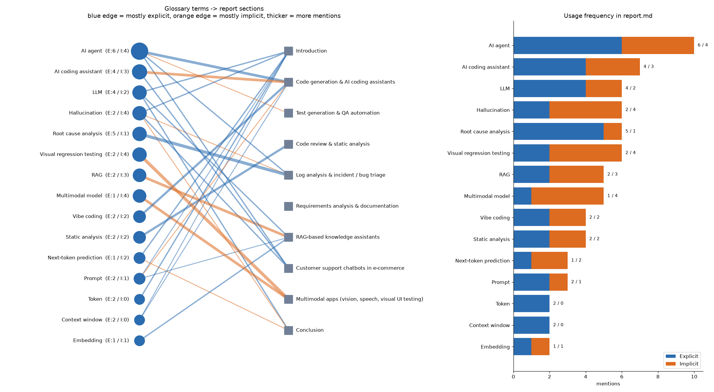

# EPAM × Tech Orda — Generative AI for Software Development

My practical work for the course. One folder per module.

## 01-intro — Research on Generative AI applications

| File | What it is |
|---|---|
| [report.md](01-intro/report.md) | Research report: 8 GenAI use cases in software development, with business value, challenges, weak points and real implementations |
| [glossary.md](01-intro/glossary.md) | 15 GenAI terms from the report, explained in my own words |
| [prompts.md](01-intro/prompts.md) | How I used GitHub Copilot (Agent mode) and the prompts I gave it |
| [graph/](01-intro/graph/) | Optional task: relationship graph between glossary terms and the report |

### Terms graph



The graph links every glossary term to the report sections where it is used.

- **Explicit usage**: the term itself or its abbreviation appears in the text (e.g. `RAG`, `Retrieval-Augmented Generation`).
- **Implicit usage**: the same idea in other words (e.g. "confidently wrong" for *hallucination*).

The term forms are listed in `graph/terms.json`. The script counts explicit forms first, then implicit ones, and never counts the same words twice.

How to rebuild it:

```bash
pip install networkx matplotlib
cd 01-intro/graph
python build_graph.py
```

Output: `terms_graph.png` (graph + bar chart) and `terms_stats.json` (raw numbers per term and per section).
